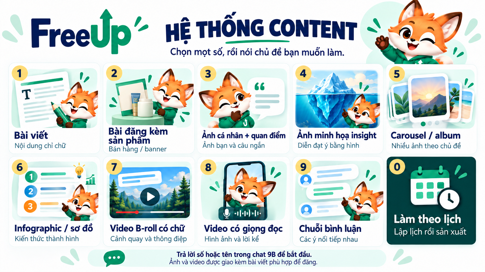

# FreeUp Content Gọn

Quà tặng làm content cá nhân hóa cho OpenClaw, 9BizClaw, Claude và Codex. **Bản 0.3.0.**

## Nhận quà

Gửi link repo này cho agent và nói:

> Cài quà tặng này cho tôi: https://github.com/phuongnguyendhtm/freeup-content-9b-lab/blob/v0.3.0/INSTALL.md

Agent đọc [INSTALL.md](INSTALL.md) và [AGENTS.md](AGENTS.md). **Trong 9B không cần mở/chọn thư mục:** bộ cài tự dùng workspace của agent đang trò chuyện, chuẩn bị tệp, bật skill qua công cụ cấu hình 9B rồi kiểm lại và mở menu. Khách không phải cài Git, nhập npm hoặc sửa API key. Chủ dùng chat điều khiển có quyền cài; nếu host yêu cầu duyệt thao tác, chủ duyệt trong 9B. Claude web/Cowork cần bước bật skill của tài khoản theo nền tảng. Link không tự cấp quyền còn thiếu.

[Tải bộ cài 0.3.0](https://github.com/phuongnguyendhtm/freeup-content-9b-lab/raw/refs/heads/main/downloads/freeup-content-gon-lab-0.3.0.zip) · [ZIP skill cho Claude](https://github.com/phuongnguyendhtm/freeup-content-9b-lab/raw/refs/heads/main/downloads/contentlab-claude-0.3.0.zip) · [SHA256](https://github.com/phuongnguyendhtm/freeup-content-9b-lab/raw/refs/heads/main/downloads/SHA256SUMS.txt)

## Bộ cài nằm ở đâu?

9B/OpenClaw dùng workspace đã đăng ký của agent hiện tại. Mã skill ở `skills/freeup-content-gon-lab`; trạng thái ở `freeup-content-gon-lab-data`; tài nguyên/thành phẩm ở **Nội dung của tôi**. Không chép vào vendor hoặc thư mục chương trình 9B, không yêu cầu khách giải nén tay. Claude Code/Codex dùng thư mục dự án họ đang làm.

Chỉ URL có thể khiến agent hỏi mục đích; dùng nguyên câu cài trên để rõ yêu cầu. Khi cài xong, chọn số trong cùng hội thoại để dùng ngay; không cần mở agent/chat mới.

## Mở menu và làm thử

Nhắn **hệ thống content**. 9B/OpenClaw/Claude Code gọi **/contentlab**; Codex gọi **$contentlab** hoặc câu tự nhiên.

| Số | Nội dung |
|---|---|
|1|Bài viết|
|2|Bài đăng kèm sản phẩm: bài bán hàng hoặc banner dùng sản phẩm thật|
|3|Ảnh cá nhân + quan điểm|
|4|Ảnh minh họa insight|
|5|Carousel / album|
|6|Infographic / sơ đồ|
|7|Video B-roll có chữ|
|8|Video có giọng đọc|
|9|Chuỗi bình luận|
|0|Làm theo lịch|

Mọi bài ảnh/video có caption phù hợp. Dùng lại hồ sơ/tri thức/ảnh doanh nghiệp sẵn có; chỉ bổ sung phần thiếu. Khách nộp tài liệu rồi nhắn **Tôi đã hoàn tất** để agent đọc lại dữ liệu thật. Thư mục khách thao tác đều tiếng Việt; thành phẩm có Bài viết.txt, Xem bài.html và ảnh/video.

## Sheet mẫu bắt buộc

Skill chứa [reference mẫu](package/skills/freeup-content-gon-lab/references/sheet-template.md), [thông số và hash](package/skills/freeup-content-gon-lab/references/sheet-template.json) và [XLSX sạch](templates/sheets/Content%20Gọn%20-%203%20trang%20tính.xlsx). Agent chỉ được copy mẫu Google hoặc import đúng XLSX; không tạo bảng tùy ý từ trang trắng.

Đúng ba tab: **00. Nguồn tham khảo**, **01. Ý tưởng**, **02. Bài viết & lịch đăng**. Trang nguồn để khách thêm nguồn riêng; không điền sẵn dữ liệu của người tặng. Chưa nối Google vẫn dùng chat/local và file mẫu. Bản sao nằm trong Drive khách, không ghi vào file mẫu.

[Hướng dẫn khách](docs/HUONG-DAN-KHACH-HANG.md) · [Cài/nâng cấp](docs/CAI-DAT-VA-CAP-NHAT.md) · [Phạm vi bản 0.3.0](docs/BAN-THU-0.3.0.md) · [Model và chi phí](docs/MODEL-VA-CHI-PHI.md)

Bộ cài kiểm hash/inventory, cài lại không nhân đôi và giữ dữ liệu khi nâng cấp. Ảnh/video cần công cụ hoặc renderer thực, được kiểm riêng. Gói mặc định tạo/sửa/duyệt/bàn giao; không tự bật đăng hoặc worker nền.

Skill: contentlab; package: freeup-content-gon-lab; dữ liệu: freeup-content-gon-lab-data. Hồ sơ/ảnh/credential của khách không nằm trong repo hoặc gói phân phối.
